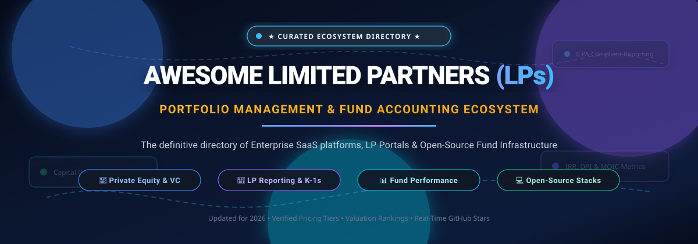
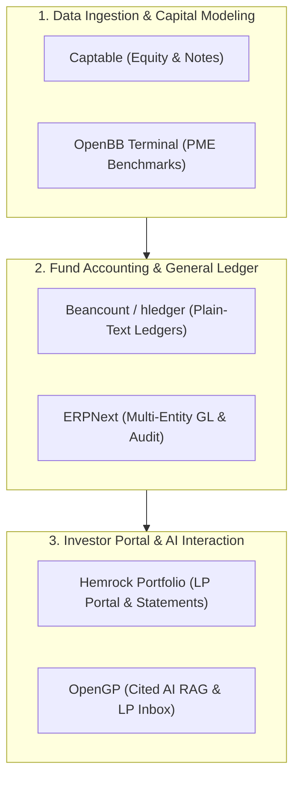

# 🏛️ Awesome Limited Partners (LPs) Portfolio Management Ecosystem

  

  
  
  
  
  
  
  

---

## 📌 Executive Summary & Introduction

Welcome to the **Curated Directory of Limited Partner (LP) Portfolio Management & Fund Accounting Technologies**. 

This comprehensive resource tracks premier **enterprise SaaS platforms** and **open-source software stacks** engineered for **Limited Partners (LPs)**, **General Partners (GPs)**, **Family Offices**, and **Fund Administrators** across Private Equity (PE), Venture Capital (VC), Real Estate, and Private Credit.

These solutions streamline critical fund management workflows:
* 📑 **LP Reporting & Distribution**: Delivering capital account statements, automated capital call notices, distribution notices, and schedule K-1 tax packages.
* 🔐 **Self-Service Investor Portals**: Providing institutional allocators with branded, 24/7 digital access to underlying portfolio metrics, fund documents, and subscription agreements.
* 🧮 **Fund Accounting & General Ledger Integration**: Synchronizing transactional cash flows, NAV calculations, management fee allocations, and waterfall carried-interest schedules.
* 📊 **Performance Analytics & Compliance**: Tracking IRR, MOIC, DPI, RVPI, and TVPI benchmarks in full alignment with Institutional Limited Partners Association ([ILPA](https://ilpa.org/)) reporting standards and SEC disclosure regulations.

---

## 📑 Table of Contents

- [🌐 Sector Overview & Market Dynamics](#-sector-overview--market-dynamics)
- [🏢 SaaS & Enterprise Hosted Platforms](#-saas--enterprise-hosted-platforms)
- [💻 Open-Source Infrastructure & GitHub Projects](#-open-source-infrastructure--github-projects)
- [🏗️ Architectural Blueprint: Building a Self-Hosted LP Stack](#️-architectural-blueprint-building-a-self-hosted-lp-stack)
- [📈 Star History](#-star-history)
- [💖 Support & Sponsoring](#-support--sponsoring)
- [🤝 How to Contribute](#-how-to-contribute)
- [⚖️ Compliance & Fiduciary Disclaimer](#️-compliance--fiduciary-disclaimer)

---

## 🌐 Sector Overview & Market Dynamics

The global alternative investment management software and LP/GP portfolio management market is estimated at **$4.8 billion in 2024**, projected to reach **$10.5 billion by 2030**, advancing at a compound annual growth rate (CAGR) of **~13.5%**. This rapid expansion is propelled by escalating private markets Assets Under Management (AUM across private equity, venture capital, private debt, and infrastructure), tightening regulatory mandates (such as SEC private fund adviser disclosure rules and ESG compliance), and institutional LP demands for real-time digital transparency and automated tax document distribution.

The sector exhibits a **moderately fragmented and bifurcated market structure**, rather than a winner-take-all monopoly. Top-tier institutional mega-funds and multi-asset sovereign allocators remain anchored to legacy enterprise conglomerates (such as S&P Global iLEVEL, BlackRock eFront, and MSCI Burgiss) due to complex multi-currency ledger engines and bespoke compliance requirements. Concurrently, mid-market private equity, emerging venture capital funds, and family offices are actively migrating to agile modern vertical SaaS platforms (such as Carta, Juniper Square, Addepar, and Vessel) or deploying modular, sovereign open-source stacks (such as Hemrock Portfolio, OpenGP, and ERPNext) to avert prohibitive enterprise lock-in and per-seat fee inflation.

---

## 🏢 SaaS & Enterprise Hosted Platforms

The following table presents premier commercial platforms for GP-LP portfolio management, investor reporting, and fund accounting. The table is ranked in **descending order by company size** (market capitalization, enterprise valuation, or annual recurring revenue).

| 🏢 Platform & Link | 📈 Company Size (Valuation / Revenue) | 💼 Key Capabilities & LP Focus | 💵 Specific Starting Tier Pricing | 🎁 Free Tier / Free Trial Limits |
| :--- | :--- | :--- | :--- | :--- |
| **[iLEVEL (S&P Global)](https://www.spglobal.com/marketintelligence/en/solutions/ilevel)** | Public (NYSE: SPGI)   **~$155 Billion Market Cap**   *(Division ARR ~$1.4B; acquired via Ipreo for $1.85B)* | Institutional private market portfolio monitoring, granular fund data capture, fund-of-funds tracking, and audit-grade LP performance analytics. | **$36,000 / year** baseline platform fee   *(Additional user licenses priced from $900/user/month; median deployment ~$60,000–$120,000/yr)* | **0 days (No free forever plan)**   *(Live interactive demonstration & sales-qualified sandbox environment only)* |
| **[eFront (BlackRock)](https://www.efront.com/)** | Public (NYSE: BLK)   **~$140 Billion Market Cap**   *(Acquired for $1.3B cash; Aladdin Alternatives ARR ~$200M+)* | Flagship *Investment Café* investor portal, secure distribution of quarterly statements, capital calls, and notice management for institutional VC/PE funds. | **$50,000 / year** entry enterprise contract   *(Multi-year enterprise agreement; scales upwards of $100,000+/yr with full Aladdin integration)* | **0 days (No free forever plan)**   *(Customized guided institutional POC and architecture audit upon formal consultation)* |
| **[Burgiss (MSCI)](https://www.burgiss.com/)** | Public (NYSE: MSCI)   **~$45 Billion Market Cap**   *(Acquired at $1.05B valuation; ~$90M ARR)* | Institutional *Private i®* platform, global private capital benchmarks, transparency data feeds, multi-asset cash flow modeling, and look-through LP reporting. | **$50,000 / year** base institutional subscription   *(Typically $50,000–$120,000+/year based on portfolio AUM, entity volume, and data feeds)* | **0 days (No free forever plan)**   *(Tailored institutional walkthrough and sample data room review upon request)* |
| **[Carta](https://carta.com/)** | Private (Series G)   **$7.4 Billion Valuation**   *(~$350M+ ARR)* | Unified LP portal for digital subscription document execution, capital account statements, K-1 distribution, cap table management, and full fund administration. | **$2,800 / year** entry corporate paid software tier   *(Fund administration packages start at ~$8,000–$12,000/yr for SPVs and micro-funds)* | **Free forever on "Carta Launch"**   *(Limited to early-stage companies with up to 25 stakeholders and under $1M capital raised; 0-day free trial on fund admin)* |
| **[Addepar](https://addepar.com/)** | Private (Series F)   **$2.17 Billion Valuation**   *(~$220M+ ARR)* | Multi-asset wealth and LP/GP portfolio reporting platform, tracking trillions in assets across alternative and liquid asset classes with branded LP reporting. | **$30,000 / year** entry institutional tier   *(Contracts scale based on total Assets Under Management and client reporting entity count)* | **0 days (No free forever plan)**   *(Guided product demo and custom data sandbox evaluation upon enterprise scoping)* |
| **[Allvue Systems](https://www.allvuesystems.com/)** | Private (Vista Equity Partners)   **$2.0B – $3.0B Valuation**   *(~$200M+ ARR)* | Configurable, white-labeled LP portal tightly integrated with back-office fund accounting, general ledger, CRM, and portfolio monitoring workflows. | **$77,500 / year** entry baseline contract   *(Procurement median contract ~$201,000/yr; requires annual or multi-year enterprise Master Agreement)* | **0 days (No free forever plan)**   *(Scoped technical architecture walkthrough and live sandbox testing for qualified firms)* |
| **[Juniper Square](https://www.junipersquare.com/)** | Private (Series C/D)   **$1.2 Billion Valuation**   *(~$75M+ ARR; $133M+ raised)* | Connected investor portal with automated capital account statement publishing, capital calls, distribution notices, and detailed LP engagement telemetry. | **$18,000 / year** starting Sponsor tier   *(Billed annually with a 12-month minimum contractual commitment; scales by equity under management)* | **0 days (No free forever plan)**   *(Interactive 1-on-1 guided product demonstration and test data sandbox upon sales review)* |
| **[Dynamo Software](https://www.dynamosoftware.com/)** | Private (Francisco Partners / Blackstone)   **~$500 Million Valuation**   *(~$54M ARR)* | End-to-end cloud platform covering deal pipelines, portfolio monitoring, investor relations, tax document delivery, and branded LP data rooms. | **$25,000 / year** baseline deployment   *(Individual CRM modules start at ~$750–$1,200/user/yr with minimum seat packaging requirements)* | **0 days (No free forever plan)**   *(Scenario-based enterprise demonstration and workflow proof-of-concept upon sales review)* |
| **[Canoe Intelligence](https://canoeintelligence.com/)** | Private (Series B)   **~$120 Million Valuation**   *(~$20M ARR; $25M raised)* | AI-native document intelligence platform automating extraction, categorization, and validation of LP capital call notices, distribution statements, and K-1s. | **$25,000 / year** base platform package   *(Tiered based on annual document processing volume and downstream accounting API integrations)* | **0 days (No free forever plan)**   *(Tailored document ingestion demo using prospective client sample notices)* |
| **[FundCount](https://fundcount.com/)** | Private / Bootstrapped   **~$30 Million Valuation**   *(~$20M ARR; 20+ years operational)* | Accounting-backed investor portal driven by a nested multi-currency general ledger; ensures investor reports reconcile to accounting books and tax records. | **$14,450 / year** ("Fund Admin Incubator" tier)   *(Includes up to 5 funds, $50M AUA per fund, and 1 user seat; additional funds at $6,450/fund/yr)* | **0 days (No free forever plan)**   *(Paid sandbox environment available at $499/month; live guided 1-on-1 walkthrough upon request)* |
| **[Vessel](https://vessel.co/)** | Private (Venture-backed)   **~$30 Million Valuation**   *($7.5M Seed raised from Inovia & Afore)* | AI-powered investor relations and LP portal designed for emerging PE and VC fund managers; aggregates funds, SPVs, co-investments, balances, and notices in real-time. | **$83.33 / month** ($1,000 / year billed annually)   *(Starting "Basic" plan includes 100 LP profiles/month; advanced fund admin suites scale $5,000–$15,000/yr)* | **14-day free trial**   *(Includes access to core LP profiling, investor pipeline features, and data-room onboarding)* |

---

## 💻 Open-Source Infrastructure & GitHub Projects

For emerging managers, technical General Partners, and engineering teams building sovereign fund operations stacks, open-source projects provide complete data privacy, cost predictability, and zero vendor lock-in.

The repositories below are ranked in **descending order by real-time GitHub Stars_Count**. Each repo includes a direct stargazers badge linking to the project's stargazers community.

---

### 1. 📊 [OpenBB Terminal](https://github.com/OpenBB-finance/OpenBB)

* **Repository**: [`OpenBB-finance/OpenBB`](https://github.com/OpenBB-finance/OpenBB)
* **License**: AGPL-3.0
* **Primary Stack**: Python, FastAPI, TypeScript
* **Core Capabilities**: Open-source investment research terminal and multi-asset data intelligence platform. Enables fund managers and analysts to extract macroeconomic indicators, private capital datasets, equity benchmarks, and public filings directly into automated reporting pipelines or AI agent workflows.

---

### 2. 🏢 [Odoo Community Edition](https://github.com/odoo/odoo)

* **Repository**: [`odoo/odoo`](https://github.com/odoo/odoo)
* **License**: LGPL-3.0
* **Primary Stack**: Python, JavaScript, PostgreSQL
* **Core Capabilities**: Extensible open-source enterprise resource planning (ERP) platform. Features double-entry accounting ledgers, multi-company consolidation, secure document management, and client portal modules easily customized to host LP document repositories, capital notice distribution, and compliance audit trails.

---

### 3. 💰 [Maybe Finance](https://github.com/maybe-finance/maybe)

* **Repository**: [`maybe-finance/maybe`](https://github.com/maybe-finance/maybe)
* **License**: AGPL-3.0
* **Primary Stack**: Ruby on Rails, Hotwire, PostgreSQL
* **Core Capabilities**: Self-hosted wealth and portfolio tracking application originally engineered as a commercial SaaS product. Delivers multi-currency balance sheet management, investment holding tracking, performance visualizer, and advisor-assisted data visibility ideal for family offices and individual LP asset monitoring.

---

### 4. 📚 [ERPNext](https://github.com/frappe/erpnext)

* **Repository**: [`frappe/erpnext`](https://github.com/frappe/erpnext)
* **License**: GPL-3.0
* **Primary Stack**: Python (Frappe Framework), MariaDB / PostgreSQL, JavaScript
* **Core Capabilities**: Enterprise-grade open-source ERP system featuring robust double-entry general ledger accounting, cost center segregation, tax compliance rules, bank feed reconciliation, and custom portal builder. Extensively used by fund administrators to generate auditable financial statements and capital account summaries.

---

### 5. 🔒 [Actual Budget](https://github.com/actualbudget/actual)

* **Repository**: [`actualbudget/actual`](https://github.com/actualbudget/actual)
* **License**: MIT
* **Primary Stack**: Node.js, SQLite, TypeScript, WebAssembly
* **Core Capabilities**: Local-first, privacy-focused financial management tool with zero-knowledge end-to-end synchronization. Provides fine-grained transaction ledger management, custom categorization rules, and strict reconciliation mechanisms for tracking SPV-level administrative disbursements and fund fees.

---

### 6. 📈 [yfinance](https://github.com/ranaroussi/yfinance)

* **Repository**: [`ranaroussi/yfinance`](https://github.com/ranaroussi/yfinance)
* **License**: Apache-2.0
* **Primary Stack**: Python, Pandas, Requests
* **Core Capabilities**: Reliable market data downloader used extensively by fund engineers to fetch public market benchmarks (e.g., S&P 500, Russell 2000, NASDAQ) for calculating public market equivalent (PME) metrics (such as Kaplan-Schoar PME and Direct Alpha) against private fund cash flows.

---

### 7. 🛡️ [Firefly III](https://github.com/firefly-iii/firefly-iii)

* **Repository**: [`firefly-iii/firefly-iii`](https://github.com/firefly-iii/firefly-iii)
* **License**: AGPL-3.0
* **Primary Stack**: PHP (Laravel), MySQL / PostgreSQL, Vue.js
* **Core Capabilities**: Self-hosted financial management application supporting double-entry bookkeeping, multi-entity account trees, automated transaction rule engines, and cash-flow reporting. Well-suited for syndicate leads and angel funds monitoring vehicle-level operating expenses.

---

### 8. 💼 [Ghostfolio](https://github.com/ghostfolio/ghostfolio)

* **Repository**: [`ghostfolio/ghostfolio`](https://github.com/ghostfolio/ghostfolio)
* **License**: AGPL-3.0
* **Primary Stack**: TypeScript, Angular, NestJS, Prisma, PostgreSQL
* **Core Capabilities**: Privacy-centric wealth management platform designed to track asset allocations, cash positions, sector exposure, and portfolio performance across multiple custody accounts without compromising proprietary investor data.

---

### 9. 📝 [Beancount](https://github.com/beancount/beancount)

* **Repository**: [`beancount/beancount`](https://github.com/beancount/beancount)
* **License**: GPL-2.0
* **Primary Stack**: Python, Plain Text Accounting
* **Core Capabilities**: Plain-text double-entry fund accounting system. Allows fund managers to define immutable journal entries in plain text files, version-control them using Git, and programmatically generate balance sheets, income statements, and capital account records suitable for automated LLM parsing and auditing.

---

### 10. ⚡ [hledger](https://github.com/hledgerorg/hledger)

* **Repository**: [`hledgerorg/hledger`](https://github.com/hledgerorg/hledger)
* **License**: GPL-3.0
* **Primary Stack**: Haskell, CLI, Web UI
* **Core Capabilities**: High-performance plain-text accounting software providing command-line, terminal UI, and web interfaces for auditing financial ledgers, tracking partnership capital accounts, and verifying fund transaction histories with zero database overhead.

---

### 11. 🎯 [Portfolio Performance](https://github.com/portfolio-performance/portfolio)

* **Repository**: [`portfolio-performance/portfolio`](https://github.com/portfolio-performance/portfolio)
* **License**: Eclipse Public License 2.0
* **Primary Stack**: Java, Eclipse RCP
* **Core Capabilities**: Mature open-source desktop software for calculating exact internal rate of return (IRR), true time-weighted rate of return (TTWROR), capital drawdown analysis, and benchmark comparisons across fund vehicles, equity holdings, and fixed-income portfolios.

---

### 12. 🔐 [Rotki](https://github.com/rotki/rotki)

* **Repository**: [`rotki/rotki`](https://github.com/rotki/rotki)
* **License**: AGPL-3.0
* **Primary Stack**: Python, Vue.js, TypeScript, Electron
* **Core Capabilities**: Privacy-first portfolio tracking, analytics, and accounting application. Encrypts all data locally on disk, offers multi-platform exchange/wallet decoding, and creates structured profit-and-loss reports for crypto, Web3, and alternative funds.

---

### 13. 📑 [Captable](https://github.com/captableinc/captable)

* **Repository**: [`captableinc/captable`](https://github.com/captableinc/captable)
* **License**: MIT
* **Primary Stack**: TypeScript, React, Node.js
* **Core Capabilities**: Modern open-source cap table and equity management platform positioned as an alternative to Carta, Pulley, and AngelList. Calculates fully diluted share capitalizations, SAFE/convertible note conversions, round modeling, and shareholder distribution ledgers.

---

### 14. 🚀 [Hemrock Portfolio](https://github.com/tdavidson/portfolio)

* **Repository**: [`tdavidson/portfolio`](https://github.com/tdavidson/portfolio)
* **License**: Apache-2.0
* **Primary Stack**: Node.js, TypeScript, PostgreSQL, Model Context Protocol (MCP)
* **Core Capabilities**: End-to-end self-hostable platform built specifically by a venture fund CFO for emerging funds, SPVs, and syndicates. Features:
  - 📊 **Portfolio Reporting**: Ingests founder updates and extracts structured operating metrics into LP summaries.
  - 📑 **LP Reporting Portal**: Issues capital account statements with an embedded AI analyst that answers LP questions strictly from fund-approved disclosures.
  - 🧮 **Fund Operations & Accounting**: Double-entry plain-text ledger per vehicle, capital call distribution, and compliance calendars.
  - 🤖 **Model Context Protocol (MCP) Server**: Allows Claude or ChatGPT to securely query fund and LP metrics with strict authentication.

---

### 15. 🌐 [LibreFolio](https://github.com/Librefolio/LibreFolio)

* **Repository**: [`Librefolio/LibreFolio`](https://github.com/Librefolio/LibreFolio)
* **License**: GPL-3.0
* **Primary Stack**: TypeScript, Node.js, Docker
* **Core Capabilities**: Self-hosted financial portfolio tracker for multi-broker investments, cash accounts, and loans. Automates market pricing feeds, currency conversions, and transparent runtime calculations for FIFO/WAC cost basis and TWRR/MWRR return rates.

---

### 16. 🤖 [OpenGP](https://github.com/vivan1211/opengp)

* **Repository**: [`vivan1211/opengp`](https://github.com/vivan1211/opengp)
* **License**: AGPL-3.0
* **Primary Stack**: Python, TypeScript, PostgreSQL (pgvector), AWS Terraform
* **Core Capabilities**: Open-source AI intelligence platform for private equity funds (alternative to Rogo and Hebbia). Deploys entirely inside the firm's private AWS VPC with ~77 Terraform resources:
  - 🔍 **Cited RAG Chat**: Answers investor and partner queries grounded with clickable citations across the confidential data room.
  - 📈 **Portfolio Analytics**: MOIC, IRR, DPI KPIs, and dynamic AI chart builder.
  - 📬 **LP Inbox Triaging**: Drafts cited responses to incoming LP inquiries for human GP approval prior to sending.
  - 🛡️ **Multi-Tenant White-Labeling**: Custom branding and Postgres row-level security per fund vehicle.

---

## 🏗️ Architectural Blueprint: Building a Self-Hosted LP Stack

Firms aiming to eliminate per-seat SaaS costs while preserving institutional governance can synthesize an end-to-end self-hosted stack by integrating these complementary open-source modules:

1. **Cap Table & Ownership Layer**: Deploy [Captable](https://github.com/captableinc/captable) to model company cap tables, convertible instruments, and pro-rata ownership.
2. **Fund Accounting Engine**: Implement [Hemrock Portfolio](https://github.com/tdavidson/portfolio) combined with [Beancount](https://github.com/beancount/beancount) or [ERPNext](https://github.com/frappe/erpnext) for auditable, double-entry partnership general ledgers and capital account tracking.
3. **PME Benchmarking**: Fetch public indices and macro rates using [OpenBB](https://github.com/OpenBB-finance/OpenBB) and [yfinance](https://github.com/ranaroussi/yfinance) for Kaplan-Schoar PME calculations.
4. **AI-Powered LP Portal**: Connect [Hemrock Portfolio](https://github.com/tdavidson/portfolio) and [OpenGP](https://github.com/vivan1211/opengp) in your private cloud to deliver white-labeled LP portals, cited Q&A over fund documents, and automated draft email responses for incoming investor queries.

---

## 📈 Star History

---

## 💖 Support & Sponsoring

Thank you for exploring and supporting the **Awesome Limited Partners (LPs) Portfolio Management Ecosystem**!

Maintaining accurate enterprise pricing datasets, auditing emerging open-source codebases, and curating private capital tools requires ongoing research. If this directory assists your investment committee, fund operations team, or development roadmap, please consider supporting the project:

* ⭐ **Star this repository**: Click the star button at the top right of this page to increase visibility and help other fund managers find these resources.
* 🍴 **Fork & Contribute**: Share your firm's open workflows, submit updates to pricing models, or propose emerging software platforms.
* 📢 **Spread the Word**: Recommend this list to fellow General Partners, LPs, CFOs, fund accountants, and fintech builders.
* ☕ **Sponsor the Maintainer**: Support continuous research and maintenance by visiting the official **[GitHub Sponsor Dashboard](https://github.com/sponsors/ishandutta2007)**.

---

## 🤝 How to Contribute

We actively welcome contributions from GPs, LPs, fund administrators, financial software engineers, and researchers!

To add or update an entry:
1. Fork this repository.
2. Ensure new additions align with the standards of the **[Awesome-Awesome-Awesome](https://github.com/ishandutta2007/Awesome-Awesome-Awesome)** ecosystem.
3. Update `README.md` following the established tabular structure for SaaS products (including specific entry pricing, free tier/trial terms, and valuation benchmarks) or the detailed format for open-source repositories (including real-time social Stars_Badges linking to `/stargazers`).
4. Submit a descriptive Pull Request highlighting official documentation or verification sources.

---

## ⚖️ Compliance & Fiduciary Disclaimer

* **Informational & Educational Purpose**: This repository is a community-curated directory compiled for educational, technological, and research purposes. It does not constitute investment advice, legal guidance, tax counseling, or formal financial auditing services.
* **Fiduciary Verification**: LP reporting, NAV calculations, capital account statements, waterfall distributions, and Schedule K-1 distributions involve legal and regulatory compliance obligations (including SEC, FINRA, and IRS mandates). All financial figures, data extracts, and AI-generated summaries produced by self-hosted or commercial tools must be audited by qualified Certified Public Accountants (CPAs) and fund administration professionals before investor distribution.
* **Security & Infrastructure**: Deploying self-hosted open-source software handling investor personally identifiable information (PII) and banking wires demands rigorous infrastructure hardening, encrypted database backups, multi-factor authentication (MFA), and compliance with SOC-2, GDPR, and ISO-27001 security standards.

---

  <b>Built with ❤️ for General Partners, Limited Partners, Fund Accountants, and Alternative Asset Technologists worldwide.</b> 
  Let's build more transparent, modern, and open fund operations together.

